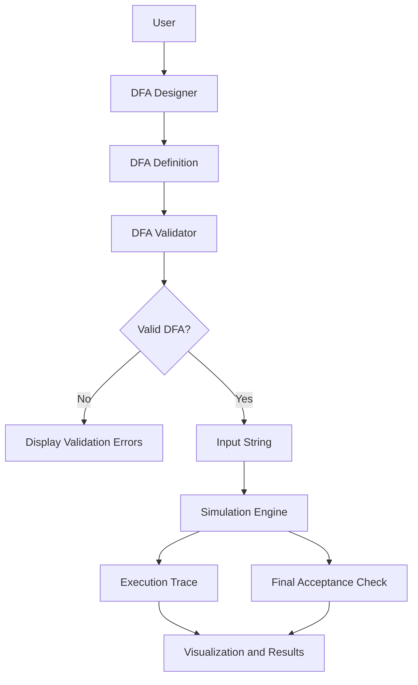

# System Architecture

## 1. Overview

DFA Studio will use a modular, client-side architecture. The application will run in a web browser and will not require a backend server or database for the initial version.

The system is divided into four main components:

1. **DFA Designer** — collects and edits the DFA definition, including states, alphabet, initial state, accepting states and transitions.
2. **DFA Validator** — checks whether the supplied definition satisfies the structural requirements of a complete DFA.
3. **Simulation Engine** — processes an input string by repeatedly applying the DFA transition function.
4. **Visualization and Results** — displays the state diagram, current execution state, execution trace and final acceptance result.

## 2. Component Responsibilities

### 2.1 DFA Designer

- Add, rename and remove states.
- Define the input alphabet.
- Select exactly one initial state.
- Mark zero or more accepting states.
- Define one destination state for each state-symbol pair.
- Make the DFA definition available to the validator.

### 2.2 DFA Validator

The validator checks that:

- The state set is finite and non-empty.
- The alphabet is finite and non-empty.
- The initial state belongs to the state set.
- Every accepting state belongs to the state set.
- Every transition source and destination belongs to the state set.
- Every transition symbol belongs to the alphabet.
- Exactly one transition exists for every state-symbol pair.

The initial version will require a complete transition function. An incomplete definition will be reported as invalid before simulation.

### 2.3 Simulation Engine

- Start from the initial state.
- Read the input string from left to right.
- Use the current state and next input symbol to look up the next state.
- Record each transition in an execution trace.
- After all symbols are consumed, check whether the current state is accepting.

### 2.4 Visualization and Results

- Display states and directed transitions as a diagram.
- Distinguish the initial state and accepting states.
- Highlight the current state and active transition during step-by-step execution.
- Display the transition table and execution trace.
- Show the final accepted or rejected result.

## 3. High-Level Data Flow

1. The user defines an automaton in the DFA Designer.
2. The definition is passed to the DFA Validator.
3. If validation fails, the application displays the relevant errors and does not start simulation.
4. If validation succeeds, the user supplies an input string.
5. The Simulation Engine processes the string using the transition function.
6. The Visualization and Results component displays the execution and final result.

## 4. Architecture Diagram

## 5. Proposed Technology Stack

| Layer | Technology | Purpose |
|---|---|---|
| Structure | HTML | Application layout |
| Styling | CSS | Visual design and responsive layout |
| Interaction | JavaScript | User actions and application logic |
| DFA processing | JavaScript | Validation and simulation |
| Diagram rendering | SVG | State and transition visualization |
| Version control | Git and GitHub | Source-code and documentation management |

## 6. Architectural Scope

The initial application will be a client-side web application. DFA definitions and simulation data will be managed in browser memory. Persistent storage, authentication, backend services and database integration are outside the initial M1 scope.