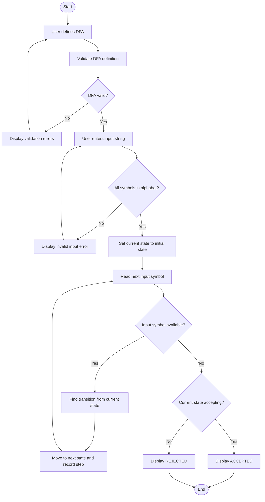

# System Flowchart

## 1. Purpose

The flowchart describes how DFA Studio validates a DFA definition and processes an input string.

## 2. Flowchart

## 3. Flowchart Explanation

1. The user defines the DFA.
2. The system validates the states, alphabet, initial state, accepting states and transition function.
3. If the definition is invalid, the system displays errors and asks the user to correct it.
4. If the definition is valid, the user enters an input string.
5. The system checks that every input symbol belongs to the defined alphabet.
6. The simulation starts from the initial state.
7. The system reads each symbol and follows the corresponding transition, recording each step.
8. After all symbols have been processed, the system checks whether the current state is accepting.
9. The system displays ACCEPTED or REJECTED.

## 4. Empty Input

The empty string contains no input symbols. In that case, the simulation performs no transitions and checks whether the initial state is accepting.