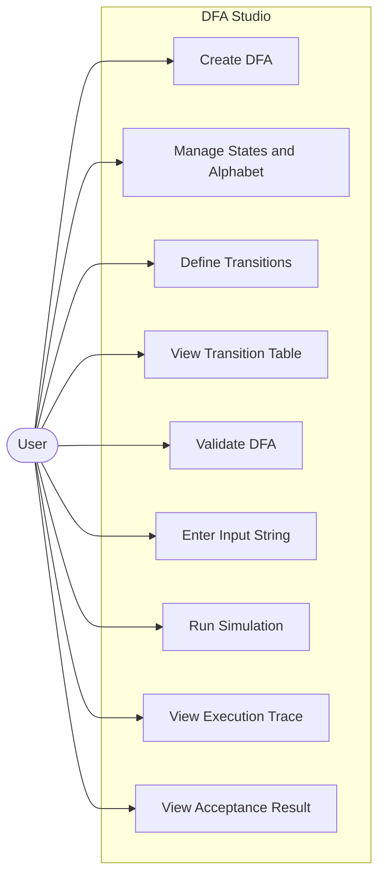

# Use Case Diagram

## 1. Primary Actor

**User** — a student or learner who designs a deterministic finite automaton and tests input strings.

## 2. Use Cases

- Create a DFA.
- Add, rename and remove states.
- Define the input alphabet.
- Select the initial state.
- Mark accepting states.
- Define state transitions.
- View the transition table.
- Validate the DFA definition.
- Enter an input string.
- Run the simulation.
- View the execution trace.
- View the final acceptance or rejection result.

## 3. Use Case Diagram

## 4. Description

The user creates and configures a DFA by defining its states, alphabet, initial state, accepting states and transitions. The user can inspect the generated transition table, validate the automaton, enter an input string and start simulation. The application then presents the execution trace and final result.